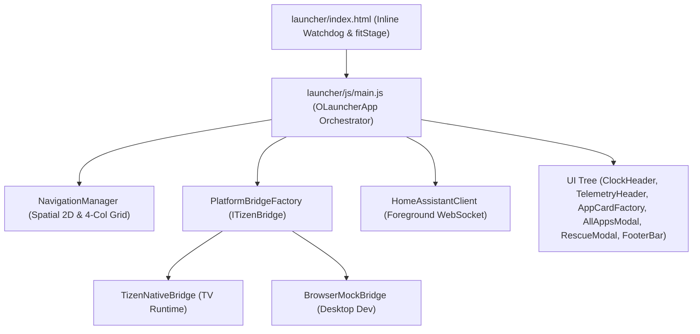

# OLauncher — 4K Minimalist TV Launcher for Samsung Tizen 6.5

[](./LICENSE)
[](#tested-hardware--requirements)
[-22c55e.svg)](#architecture-overview)
[](./package.json)

A lightweight, ad-free, **4K minimalist TV home launcher (`.wgt`)** and **native C++ recovery toolkit** engineered for Samsung Tizen 6.5 smart TVs—combining locked 60 FPS GPU-composited glassmorphism, Home Assistant telemetry & Siri voice control, 0ms multitasking resume, and a 3-layer fail-safe recovery net.

> [!WARNING]
> **Safety & Warranty Disclaimer:**
> The native C++ utilities ([`native/tools/olauncher_native_ctl.cpp`](native/tools/olauncher_native_ctl.cpp) and [`native/rescue_app/`](native/rescue_app/src/rescue_main.cpp)) modify Samsung Tizen's internal `vconf` (`db/appfw/home_appid`) and AUL default application settings to remap the physical **Home** button. Behavior may vary across TV model families and firmware versions. Use at your own risk—always inspect and back up your current TV configuration (`query`) before applying changes, and keep the recovery workflow ready.

---

## Table of Contents

- [Key Features](#key-features)
- [Tested Hardware & Requirements](#tested-hardware--requirements)
- [Architecture Overview](#architecture-overview)
- [3-Layer Safety & Recovery Net](#3-layer-safety--recovery-net)
- [Quickstart (Desktop Simulator)](#quickstart-desktop-simulator)
- [Configuration (`launcher/config.json`)](#configuration-launcherconfigjson)
- [Home Assistant & Apple Siri Integration](#home-assistant--apple-siri-integration)
- [Packaging & TV Deployment](#packaging--tv-deployment)
- [NPM Scripts, Testing & Hygiene Audit](#npm-scripts-testing--hygiene-audit)
- [Project Structure & Documentation Index](#project-structure--documentation-index)
- [Security & Privacy Design](#security--privacy-design)
- [Contributing](#contributing)
- [License](#license)

---

## Key Features

* **4K Canvas with 1080p Logical Coordinate Fit:** Authored on a `3840x2160` stage (`#stage`) and scaled cleanly via an inline pre-paint `fitStage()` transform in [`launcher/index.html`](launcher/index.html) to match Tizen Web Engine's `1920x1080` logical CSS viewport (`scale = 0.5`) with zero horizontal/vertical overflow.
* **Zero-Blur 60 FPS Prismatic Glassmorphism:** Replaces expensive `backdrop-filter: blur()` passes (which drop Mali-G52 GPUs to 15–20 FPS) with layered translucent gradients, 2px top bevel highlights (`::after`), 140° specular sheen (`::before`), and inset rim lighting.
* **Fixed 7-Card Home Rail + 2D App Catalog:** Locks the home rail strictly to 7 stage cards (`Web Tarayıcı`, `XBOX (HDMI 2)`, `Stremio`, `Spotify`, `YouTube`, `Netflix`, and `DİĞER UYGULAMALAR`) to prevent viewport shifting, backed by a 4-column 2D D-pad modal (`AllAppsModal`) filtering out 50+ internal Samsung background daemons.
* **Instant 0ms Multitasking Resume & Zero Z-Stack Flash:** Uses `multitasking.support="true"` and `homereturnsupport="true"` without premature `currentApp.hide()`, suspending timers and WebSockets only on `visibilitychange` (`document.hidden === true`).
* **Clean Browser Focus Handoff (Anti-Cursor-Warp):** Detaches DOM/window focus (`window.blur()` + `document.activeElement.blur()`) before launching apps like `org.tizen.browser`, eliminating Enlightenment compositor's 30-second fullscreen cursor-warp bug without disabling global `pointing_available` pointer support.
* **HDR10+ Tile-Damage Isolation:** Isolates `.modal-dialog` (`contain: paint; isolation: isolate; transform: translate3d(0, 0, 0)`) with $N=1$ dynamic `.is-focused` layer promotion and `_rehydrateGpuSurface()` on resume to prevent Mali-G52 $X=1024\text{px}$ tile splits after HDR10+ playback.
* **Home Assistant & Apple Siri Voice Control:** Persistent foreground-only WebSocket telemetry (`climate.*` / `sensor.*`, `weather.*`), active source synchronization (`input_select.*`), and `tizen_tv_action` event handling for Siri / Apple HomeKit shortcuts.

---

## Tested Hardware & Requirements

| Component | Verified Specification / Requirement | Notes |
| :--- | :--- | :--- |
| **TV Hardware** | Samsung 65QN95B (2022 QLED Neo) | Model code `QE65QN95BATXTK`, SoC `22_PONTUSM_QTV` (ARMv7 32-bit, Mali-G52 GPU) |
| **TV OS / Runtime** | Tizen 6.5 (Chromium 85 Web Engine) | Target `esbuild` output: `chrome85` / `es2020` IIFE bundle |
| **Build & Dev Runtime** | Node.js `>= 16.10` + `npm` | Installs `esbuild` devDependency (`zero` runtime dependencies) |
| **Packaging Tool** | `zip` CLI | Used by [`tools/package-wgt.sh`](tools/package-wgt.sh) to create `dist/olauncher.wgt` |
| **HA Scripts *(Optional)*** | Python `3.x` | Standard library only (`urllib.request`) for Home Assistant CLI helpers |
| **Sideloading *(macOS ARM64)*** | Apps2Samsung or Tizen `sdb` | Apple Silicon without Rosetta 2 can sideload `.wgt` via Apps2Samsung |

---

## Architecture Overview

OLauncher uses **zero frontend frameworks** (pure ES6 modules + Vanilla CSS) structured around Adapter/Bridge, Pub-Sub `EventBus`, Factory, and Spatial 2D Navigation patterns:



Deep-dive technical specifications:
- [docs/ARCHITECTURE.md](docs/ARCHITECTURE.md) — Subsystem specifications, lifecycle handoff, and HDR10+ compositing details.
- [docs/architectural_decisions.md](docs/architectural_decisions.md) — ADRs covering dual-repo isolation, 1080p scaling, zero-blur glass, deferred surface yield, and tile isolation.
- [docs/disassembly/README.md](docs/disassembly/README.md) — Root-cause summary of the Tizen 6.5 fullscreen browser cursor-warp fix.

---

## 3-Layer Safety & Recovery Net

1. **Layer 1 — Inline Crash-Loop Watchdog ([`launcher/index.html`](launcher/index.html)):** Tracks runtime errors in `sessionStorage`; if **3 crashes occur within 15 seconds**, it automatically launches Samsung Smart Hub (`com.samsung.tv.csfs`, falling back to `com.samsung.tv.home`).
2. **Layer 2 — On-Screen Rescue Menu (`RescueModal`):** Accessible anytime from the top-right wrench icon (🔧) to switch back to Smart Hub or invoke the native rescue service.
3. **Layer 3 — Native C++ Control & Headless Rescue:**
   - [`native/tools/olauncher_native_ctl.cpp`](native/tools/olauncher_native_ctl.cpp): Verifies 32-bit ARM (`sizeof(void*) == 4`) and SDK Developer UID `901` before reading or updating `db/appfw/home_appid`, with automatic readback verification and rollback on mismatch.
   - [`native/rescue_app/src/rescue_main.cpp`](native/rescue_app/src/rescue_main.cpp): Headless Tizen service (`com.muhendisbey.olauncher.rescue`) that restores `com.samsung.tv.csfs` and relaunches Smart Hub immediately.

---

## Quickstart (Desktop Simulator)

Preview the full 4K layout, D-pad navigation, modals, and live telemetry on your computer with **no TV required**:

```bash
# 1. Install build/dev tooling
npm install

# 2. Start the loopback dev server + Mock Home Assistant WebSocket server
npm run dev
```

Open **`http://127.0.0.1:8080`** in your browser.

| Key | Action |
| :--- | :--- |
| **Arrow Keys** | Navigate across the 7-card rail, top-right wrench button, or 4-column All-Apps grid |
| **Enter** | Launch app / switch HDMI input / open modal |
| **Esc** or **Backspace** | Close active modal (`AllAppsModal` / `RescueModal`) |

> **Note:** [`tools/dev-server.mjs`](tools/dev-server.mjs) binds strictly to `127.0.0.1`, automatically falls back to [`launcher/config.example.json`](launcher/config.example.json) when `launcher/config.json` is absent, and overwrites `access_token` with `'MOCK_TOKEN'` whenever mock Home Assistant mode is active.

---

## Configuration (`launcher/config.json`)

Create your gitignored local configuration from the tracked example template:

```bash
cp launcher/config.example.json launcher/config.json
```

### Configuration Sections

| Key | Description |
| :--- | :--- |
| `household.family_name` | Displayed in the top-left greeting header (`ClockHeader`). |
| `locale` | UI locale code (default: `"tr-TR"`; extensible via [`launcher/js/i18n/index.js`](launcher/js/i18n/index.js) and [`launcher/js/i18n/tr.js`](launcher/js/i18n/tr.js)). |
| `display.wallpaper` | Background wallpaper path relative to `launcher/` (default: `"assets/wallpapers/default-wallpaper.svg"`). |
| `boot` | Optional cinematic boot screen (`enabled`, `sound`, `duration_ms`, `title`, `subtitle`). |
| `home_assistant` | WebSocket URL, `access_token`, entity IDs (`temperature`, `weather`), `device_id`, and `source_select_entity`. |
| `inputs` | Fixed HDMI source cards (e.g. `HDMI 2` XBOX card with `after_switch: "viewer"`). |
| `apps` | `browser` app definition, `pinned` app list (`id` + `label`), and `rail_limit` (keep `7` for the 3840px stage). |
| `system` | `self_app_id`, `smart_hub_app_ids` fallback list, `rescue_app_id`, and `tv_viewer_app_id`. |

### Custom Wallpaper

Place your `3840x2160` (16:9 `.jpg`/`.png`) image at a gitignored local path such as `launcher/assets/wallpapers/wallpaper.local.png` (`*.local.*` is excluded by `.gitignore`) and set:

```json
"display": {
  "wallpaper": "assets/wallpapers/wallpaper.local.png"
}
```

---

## Home Assistant & Apple Siri Integration

Update `home_assistant` in your gitignored `launcher/config.json` (the example below uses an RFC 5737 documentation IP):

```json
{
  "home_assistant": {
    "enabled": true,
    "ha_url": "ws://192.0.2.104:8123/api/websocket",
    "access_token": "YOUR_LONG_LIVED_ACCESS_TOKEN_HERE",
    "entities": {
      "temperature": "sensor.living_room_temperature",
      "weather": "weather.home"
    },
    "temperature_label": "Salon",
    "subscription_mode": "trigger",
    "remote_action_event": "tizen_tv_action",
    "device_id": "living_room_tv",
    "source_select_entity": "input_select.living_room_tv_source"
  }
}
```

### Deploying HA Scripts & Triggering Actions from CLI

Both [`tools/deploy_ha_scripts.py`](tools/deploy_ha_scripts.py) and [`tools/ha_remote_ctl.py`](tools/ha_remote_ctl.py) read credentials strictly from environment variables:

```bash
export HA_URL="http://192.0.2.104:8123"
export HA_TOKEN="YOUR_LONG_LIVED_ACCESS_TOKEN_HERE"
export TV_DEVICE_ID="living_room_tv"
export TV_MEDIA_PLAYER_ENTITY="media_player.living_room_tv"
export TV_SOURCE_SELECT_ENTITY="input_select.living_room_tv_source"

# Deploy Siri / HomeKit scripts to Home Assistant
npm run ha:deploy-scripts

# Trigger a remote action manually
python3 tools/ha_remote_ctl.py netflix
```

For full Apple Shortcuts and HomeKit Bridge setup instructions, see [docs/HOME_ASSISTANT_SIRI.md](docs/HOME_ASSISTANT_SIRI.md).

---

## Packaging & TV Deployment

### 1. Build the Tizen `.wgt` Archive

```bash
npm run package
# Bundles ES modules with esbuild (chrome85 target) and writes ./dist/olauncher.wgt
```

*(If `launcher/config.json` is absent, [`tools/build.mjs`](tools/build.mjs) bundles `launcher/config.example.json` as `config.json`.)*

### 2. Install on Samsung TV

* **Option A — Apps2Samsung (Recommended on Apple Silicon macOS):** Enable TV Developer Mode (`Apps` -> `1-2-3-4-5`), enter your host PC IP, connect to your TV IP, and install `./dist/olauncher.wgt`.
* **Option B — Tizen `sdb` CLI:**

```bash
# Query current Home app configuration (replace 192.0.2.93 with your TV IP)
./native/scripts/sdb-setup.sh 192.0.2.93 query

# Install the .wgt package
./native/scripts/sdb-setup.sh 192.0.2.93 install-wgt

# Remap the Home button to OLauncher (optional; requires compiled olauncher_native_ctl)
./native/scripts/sdb-setup.sh 192.0.2.93 apply

# Restore factory Samsung Smart Hub anytime
./native/scripts/sdb-setup.sh 192.0.2.93 restore
```

See [docs/TIZEN_DEV_GUIDE.md](docs/TIZEN_DEV_GUIDE.md) for Developer Mode setup, key codes, and sideloading tips.

---

## NPM Scripts, Testing & Hygiene Audit

| Script | Purpose |
| :--- | :--- |
| `npm start` / `npm run dev` | Starts loopback simulator (`http://127.0.0.1:8080`) with Mock Home Assistant (`127.0.0.1:8123`). |
| `npm run dev:real-ha` | Starts loopback simulator using `launcher/config.json` against your live Home Assistant. |
| `npm test` / `npm run check` | Runs automated suite (`tools/test.mjs`): config schema, `config.xml` manifest/privileges, `node --check` on all JS files, WebSocket teardown & lifecycle checks, C++ safety guards, Python syntax, and log redaction. |
| `npm run hygiene` | Runs `tools/hygiene-check.mjs`: scans every Git-tracked file for secrets, JWT headers, RFC 1918 LAN IPs, workstation paths, and forbidden local files. |
| `npm run build` | Bundles `launcher/js/main.js` (`chrome85`) and copies assets into `dist/wgt/`. |
| `npm run package` | Runs `npm run build` and packages `dist/olauncher.wgt`. |
| `npm run preview:dist` | Previews the built `dist/wgt/` directory without the mock HA server. |
| `npm run ha:deploy-scripts` | Pushes Home Assistant Siri scripts using `HA_URL` and `HA_TOKEN`. |
| `npm run version:patch` / `minor` / `major` | Synchronizes version across `package.json`, `launcher/config.xml`, and `launcher/js/core/Version.js`. |

GitHub Actions CI ([`.github/workflows/ci.yml`](.github/workflows/ci.yml)) automatically runs `npm run hygiene`, `npm test`, `npm run package`, and `.wgt` artifact cleanliness verification on pushes and pull requests to `main`.

---

## Project Structure & Documentation Index

```text
olauncher/
├── .github/workflows/ci.yml            # CI: hygiene, tests, and WGT packaging check
├── .vscode/tasks.json                  # Editor tasks (build, test, hygiene, simulator, HA deploy)
├── AGENTS.md                           # Engineering invariants & TV hardware constraints
├── LICENSE                             # MIT License
├── package.json                        # Scripts & esbuild devDependency
├── docs/
│   ├── ARCHITECTURE.md                 # Component architecture & Tizen lifecycle
│   ├── architectural_decisions.md      # ADRs (001–005)
│   ├── HOME_ASSISTANT_SIRI.md          # Home Assistant & Apple Siri setup guide
│   ├── TIZEN_DEV_GUIDE.md              # Developer Mode & Apps2Samsung deployment guide
│   └── disassembly/README.md           # Fullscreen browser cursor-warp root-cause summary
├── launcher/
│   ├── index.html                      # Entrypoint, crash-loop watchdog & fitStage()
│   ├── config.xml                      # Tizen 6.5 manifest (OLauncher1.OLauncher)
│   ├── config.example.json             # Public-safe template configuration
│   ├── css/style.css                   # 4K glassmorphism styles & HDR10+ containment
│   ├── assets/                         # Embedded font, boot assets & default-wallpaper.svg
│   └── js/                             # Vanilla ES6 modules (config, core, ha, i18n, input, platform, ui)
├── native/
│   ├── CMakeLists.txt                  # C++17 build definition
│   ├── tools/olauncher_native_ctl.cpp  # UID-guarded vconf/AUL Home control CLI
│   ├── rescue_app/                     # Headless Tizen Smart Hub rescue service
│   └── scripts/sdb-setup.sh            # SDB helper script
└── tools/
    ├── build.mjs                       # esbuild IIFE bundler for Tizen file:// compatibility
    ├── bump-version.mjs                # SemVer synchronizer
    ├── deploy_ha_scripts.py            # Env-driven HA script uploader
    ├── dev-server.mjs                  # Loopback HTTP server with token masking
    ├── ha_remote_ctl.py                # Env-driven HA remote event trigger
    ├── hygiene-check.mjs               # Tracked-file secret & privacy scanner
    ├── mock-ha-server.mjs              # Loopback Mock HA WebSocket server
    ├── package-wgt.sh                  # .wgt zip archiver
    └── test.mjs                        # Automated integrity & unit test suite
```

---

## Security & Privacy Design

* **Zero-Leak Logging:** [`redactSensitive()`](launcher/js/core/Logger.js) automatically masks JWT tokens (`[REDACTED_JWT]`), Bearer headers, and JSON credential fields before logs reach console sinks or Home Assistant telemetry, while `HomeAssistantClient` prevents forwarding its own WebSocket auth logs.
* **No Secrets or LAN IPs in Git:** `launcher/config.json`, `home-baseline*.json`, `*.p12`, `.env*`, and local wallpapers (`*.local.*`) are ignored by [`.gitignore`](.gitignore) and enforced on every push by `npm run hygiene`.
* **Loopback-Only Simulator:** Both `dev-server.mjs` and `mock-ha-server.mjs` listen exclusively on `127.0.0.1` unless explicitly overridden.

---

## Contributing

Contributions, bug reports, and multi-language locale packs (`launcher/js/i18n/`) are welcome.

1. Keep the web app **dependency-free** (pure ES6 modules and CSS compatible with Chromium 85) and never introduce `backdrop-filter: blur()` or global `pointing_available` vconf mutations.
2. Ensure all checks pass before opening a pull request:
   ```bash
   npm run hygiene
   npm test
   npm run package
   ```

---

## License

Licensed under the [MIT License](./LICENSE).
